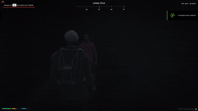

# 🎃 Ghost Hunter - Halloween Event for FiveM (ESX)

An immersive, fully-featured Halloween investigation event script for FiveM servers using the ESX Framework. Players speak to a mysterious elder NPC at night, hunt down ghosts hidden across the map, photograph them, survive dynamic jump scares, and return to claim rewards.



---

## ✨ Features

* **🌙 Nighttime Restriction**: The quest giver and spectral entities only spawn during designated night hours (fully customizable, e.g., 22:00 to 04:00).
* **🎬 Cinematic Storytelling**:
* Scripted focus camera zooms smoothly on the NPC during conversation.
* Synchronized body animations and facial lip-sync (`mic_chatter`).
* Immersive NUI voice acting (`quest_intro.mp3`) with automatic state transition upon completion.


* **📸 Interactive Photography Mechanics**:
* Prop camera attachment, realistic flash particles, and photo shooting animations.
* Anti-cheat/movement check: moving cancels the shot with a blurry-photo warning.
* Volumetric gas/smoke particle cloud continuously enveloping the spirit upon capture.
* Smooth alpha fade-out despawn effect.


* **😱 Dynamic Screamer Engine**:
* **Zero-config asset loading**: Vite's `import.meta.glob` automatically discovers and links all image/audio pairs inside `ui/src/screamers/`.
* Full-screen transparent overlay display synced to the audio file's duration.
* Physical player impact: forced ragdoll fall, camera shake, visual shock screen effects, and black screen fade transitions.


* **💾 State Persistence & Reconnect Protection**:
* Progress tracked via ESX Player Metadata (`getMeta` / `setMeta`).
* Seamlessly resumes quest progression after server restarts or client reconnects without forcing players to talk to the NPC again.
* Flexible cooldown modes: daily automated reset or unique completion per player.


* **🖥️ React & Vite HUD**:
* Clean, minimal counter displaying photographed ghosts.
* Hotkey toggle (`H`) to show/hide the HUD, map blips, and GPS routes simultaneously.


* **🛠️ Debug & Admin Commands**:
* `/resetghost [playerId]` (Admin): Clears cooldown and quest progression for testing or moderation.


---

## 📋 Requirements

* **Server Framework**: `es_extended` (Legacy with metadata support)
* **Node.js**: v16+ (only required if building/modifying the React UI)

---

## 📁 File Structure

```text
ghost_hunter/
├── fxmanifest.lua
├── config.lua
├── client/
│   └── main.lua
├── server/
│   └── main.lua
└── ui/
    ├── package.json
    ├── vite.config.js
    ├── index.html
    └── src/
        ├── App.jsx
        ├── App.css
        ├── main.jsx
        ├── sounds/
        │   └── quest_intro.mp3
        └── screamers/
            ├── ghost1.png
            ├── ghost1.mp3
            ├── monster.png
            └── monster.mp3

```

---

## ⚙️ Installation

1. **Clone or Download** this repository into your FiveM server's `resources` folder:
```bash
cd resources/
git clone [https://github.com/OldCfx/old_ghostHunter.git](https://github.com/OldCfx/old_ghostHunter.git)

```


2. **Add Assets (Optional)**:
* Place your custom intro dialogue in `ui/src/sounds/quest_intro.mp3`.
* Drop matching jump scare images (`.png`, `.jpg`, `.webp`) and audio (`.mp3`, `.wav`, `.ogg`) into `ui/src/screamers/`. Ensure paired files share the exact same filename prefix (e.g., `screamer1.png` and `screamer1.mp3`).


3. **Build the Web UI**:
```bash
cd old_ghostHunter/ui
npm install
npm run build

```


4. **Add to `server.cfg**`:
```cfg
ensure old_ghostHunter

```


---


## 🎮 Commands & Controls

| Command / Key | Permission | Description |
| --- | --- | --- |
| `E` | Player | Interact with NPC / Take ghost photograph |
| `H` | Player | Toggle HUD display, ghost blip, and GPS waypoint route |
| `/resetghost [id]` | Admin | Resets quest metadata and cooldown for target ID |

---
